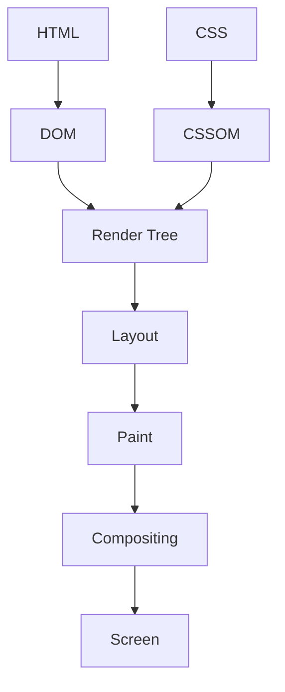
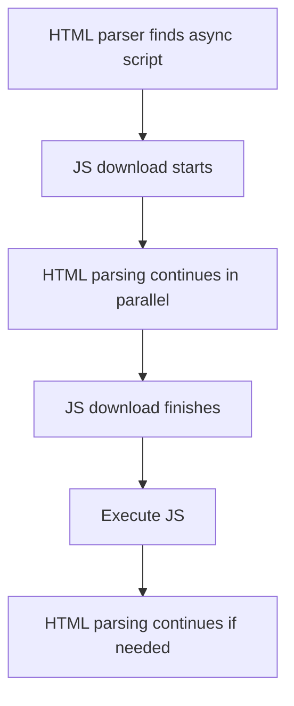
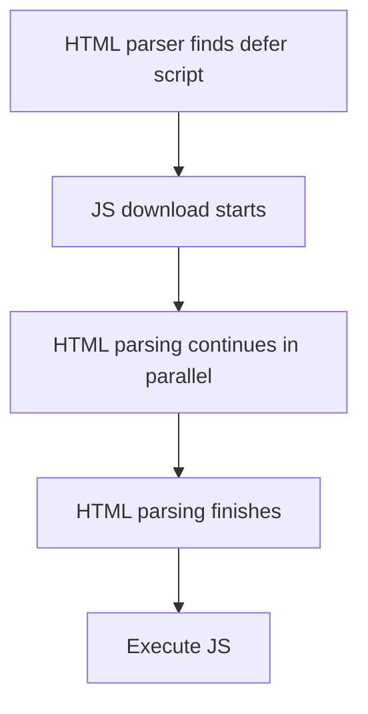
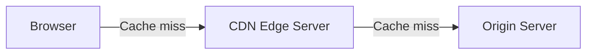
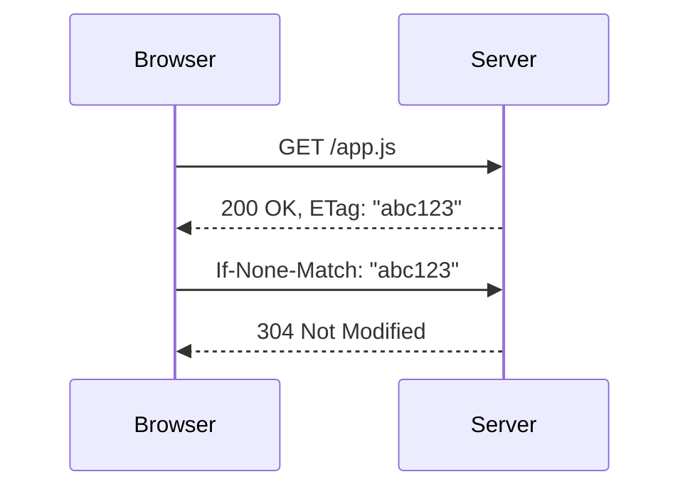
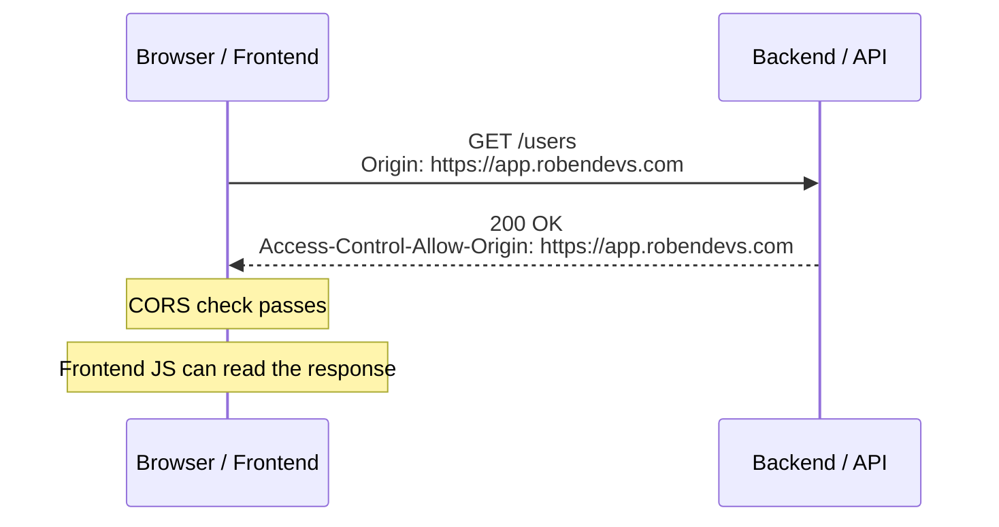

# How Browsers Work

If the browser's processing is slow, a website can take time to render even when the internet is fast.

## 1. Browser Processes

### Browser Process
- Works as the manager.
- Coordinates tabs, buttons, and other browser actions.

### Network Process
- Handles DNS, server connections, and bringing data from the server.

### Renderer Process
- Handles the website's HTML, CSS, and JavaScript.
- HTML is parsed into the **DOM**.
- CSS is parsed into the **CSSOM**.

### GPU Process
- Handles graphics-related work and helps make animations faster.

## 2. How a Page Is Rendered

The server sends HTML and CSS. The browser processes them and renders the page on the screen.

### DOM and CSSOM

- **DOM (Document Object Model):** A tree structure created when the browser parses HTML.
- **CSSOM (CSS Object Model):** A tree structure of CSS rules.
- **Render Tree:** Combines the elements and their styles from the DOM and CSSOM.



### Layout

After the render tree, the browser calculates each element's:
- Width and height
- Position
- Surrounding space

Changing a color from blue to red does not change the layout, but it does change the styling and needs repainting.

### Paint

Paint determines what needs to be drawn:
- Colors
- Text
- Images
- Borders
- Shadows

### Compositing

Combines the painted parts to produce the final screen.

## 3. What Blocks the First Paint?

The browser needs to parse HTML and process CSS before showing the page. Some JavaScript can also delay rendering.

### CSS

1. Browser starts parsing HTML.
2. It finds CSS and starts downloading it.
3. CSS is parsed and the CSSOM is created.
4. The browser can use the styles to render the page.

### JavaScript

With a normal `<script>` tag:

1. HTML parsing starts.
2. Browser finds `<script>`.
3. HTML parsing pauses while the script downloads and executes.
4. JavaScript may change the DOM.
5. HTML parsing continues.

**Solution:** Use `async` or `defer` when appropriate.

### `async`

- JavaScript downloads while HTML parsing continues.
- Once the download finishes, the script executes. If HTML parsing is still running, it pauses for execution.
- HTML parsing then continues.



### `defer`

- JavaScript downloads while HTML parsing continues.
- The browser finishes parsing HTML and creates the DOM.
- Then the deferred script executes.



## 4. Cache

The browser can get files from different places:

1. **Browser Cache:** Stores files like images, CSS, and JavaScript locally.
2. **CDN Edge Server:** Keeps content closer to users. For example, an origin server in the USA may have CDN edges in Asia and Europe.
3. **Origin Server:** The original server, usually a slower option when the content is far away.



### `Cache-Control`

An HTTP response header sent by the server. It tells the browser whether it can store a file, for how long, and whether it must check with the server before reusing it.

- `max-age`: How long the cached response stays fresh, in seconds.
- `no-cache`: Can be stored, but must be revalidated before reuse.
- `no-store`: Must not be stored.
- `public`: Can be stored by shared caches, such as a CDN.

### `ETag`

An HTTP response header used to check whether a resource has changed.



The browser sends the previous ETag with `If-None-Match`. If the resource has not changed, the server returns `304 Not Modified`.

### Cache Busting Through a Versioned Filename

Problem:
- A developer updates `app.js` but keeps the same filename.
- Its `max-age` is still valid, so the browser may keep using the old file without checking the ETag.

Solution:
- Change the filename when the content changes, for example `app.3f9a2c.js`.
- The browser sees a new filename and downloads the new file.
- Build tools like Vite can generate these hashed filenames.

## 5. Cookies and Browser Storage

HTTP is stateless. Cookies help websites remember information between requests.

### Cookie

- Small data stored by the browser.
- Example: saving a newspaper site's dark mode setting.
- The server can create a cookie by sending it to the browser.

### Session

- Temporary session information is stored on the server.
- The server creates a session ID and sends it to the browser as a cookie.

```text
Server session data:
{
  userId: 101,
  username: "karim",
  loggedIn: true
}

Session ID: abc123
```

### `localStorage`

- Stores website data in the browser.
- Data stays even after closing the browser.
- JavaScript can access it.
- It is not sent to the server automatically with requests.

### `sessionStorage`

- Stores data during a tab's session.
- Data remains after a page reload.
- Data is cleared when the tab's session ends.
- JavaScript can access it.

## 6. Cookie Security

### `HttpOnly`

- Prevents JavaScript from reading the cookie through `document.cookie`.
- Set by the server; the browser enforces it.

```http
Set-Cookie: session=abc123; HttpOnly
```

### `Secure`

- Sends the cookie only over HTTPS connections.
- HTTPS encrypts data while it travels between browser and server.

### `SameSite`

Controls when cookies are sent with cross-site requests. This helps reduce CSRF (Cross-Site Request Forgery) risks.

Example: You are logged in to `bank.com`. Another site, `evil.com`, tries to send a request to `bank.com`.

- `SameSite=Strict`: Does not send the cookie on cross-site requests.
- `SameSite=Lax`: Allows the cookie in some top-level safe navigations, such as a GET navigation.
- `SameSite=None`: Allows cross-site cookie sending; requires `Secure`.

## 7. Same-Origin Policy (SOP) and CORS

### Same-Origin Policy (SOP)

A browser restriction that stops JavaScript on one origin from reading data from another origin by default.

An **origin** is made of:

**Scheme + Host + Port**

Example:

```text
https://app.robendevs.com:443/settings

Scheme = https
Host   = app.robendevs.com
Port   = 443
Path   = /settings
```

- **Scheme:** `https`
- **Host:** `app.robendevs.com`
- **Port:** `443`
- **Path:** `/settings` (not part of the origin)

### CORS (Cross-Origin Resource Sharing)

Frontend:

```text
https://app.robendevs.com
```

Backend:

```text
https://api.robendevs.com
```

They have different origins. When frontend JavaScript makes a request to the backend, the browser checks whether the frontend is allowed to read the response.

```javascript
fetch("https://api.robendevs.com/users");
```



The **server/backend** gives CORS permission through the response header:

```http
Access-Control-Allow-Origin: https://app.robendevs.com
```

### Preflight Request

- An extra HTTP `OPTIONS` request sent by the browser before certain cross-origin requests.
- Checks whether the server allows the actual request.
- Common with methods like `PUT` and `DELETE`.

### Why Does It Work in Postman?

Postman does not enforce the browser's SOP/CORS restrictions. It sends the API request directly and does not block access to the response based on CORS headers.
