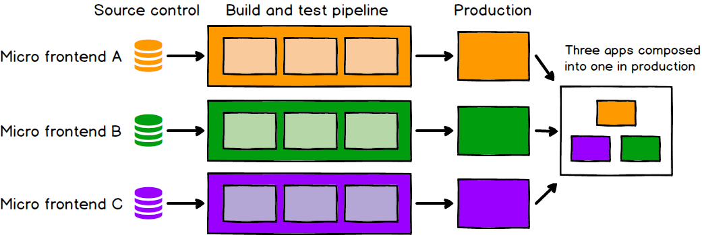
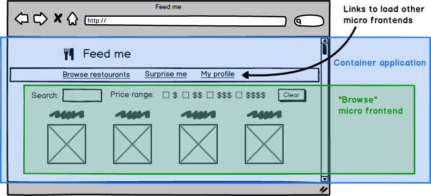

## Start With React

Components are the building blocks of UI in React.

### Implement a UI in React

**Step 1: Break the UI into a Component Hierarchy**
- Break the UI into small Components.
- Each Component should have a single responsibility.
- One Component can contain multiple Child Components.

---

**Step 2: Build the Static Version First**
- Build the UI without adding interactivity.
- Create Components that reuse other Components.
- Pass data from Parent to Child using Props.
- Props flow from Parent to Child.
- There are two approaches to building Components: Top Down and Bottom Up.

---

**Step 3: Find the Minimal but Complete Representation of UI State**
- Introduce State to make the UI interactive.
- Keep State minimal by following the DRY (Don't Repeat Yourself) principle.
- Store only necessary changing data in State.
- Keep State in the nearest common Parent Component when multiple Components need the same data (Lifting State Up).
- Derive other values from existing State instead of storing duplicate data.

**Reference:** [Thinking in React](https://react.dev/learn/thinking-in-react)

---
---
## Micro-Frontend
- An architectural style where independently deliverable frontend applications are composed into a greater whole
- Decomposing frontend monoliths into smaller, simpler chunks that can be developed, tested and deployed independently, while still appearing to customers as a single cohesive product.

### Costs:
- can lead to duplication of dependencies, increasing the number of bytes our users must download.

### Benefits:
- Independent deployment


here is a micro frontend for each page in the application, and there is a single container application, which:

    - renders common page elements such as headers and footers
    - addresses cross-cutting concerns like authentication and navigation
    - brings the various micro frontends together onto the page, and tells each micro frontend when and where to render itself



**Reference:** [Micro Frontends](https://martinfowler.com/articles/micro-frontends.html)
---

## React Router

```
index.html
    |
    v
<div id="root"></div>
    |
    v
JavaScript finds root
    |
    v
ReactDOM.createRoot(root)
    |
    v
render(<App />)
    |
    v
React UI appears inside root
```

### Outlet

- Child routes are rendered through the <Outlet/> in the parent route.

```
<Routes>
  <Route path="dashboard" element={<Dashboard />}>
    <Route index element={<Home />} />
    <Route path="settings" element={<Settings />} />
  </Route>
</Routes>
```
```
import { Outlet } from "react-router";

export default function Dashboard() {
  return (
    <div>
      <h1>Dashboard</h1>
      {/* will either be <Home/> or <Settings/> */}
      <Outlet />
    </div>
  );
}
```

## Managing State in React

- State is the information/data that React Component remembers; accourding to it's change, the Ui updates.
- Say, I have a Quiz Form that have Submit Button and Success Message. I want
    - Initial State: Submit Button will be disabled
    - Typing State: If User types, Submit Button will be enabled
    - Success State: After submission, Success message will show

  For this, I only use a *status* state; it changes states User's action.

```
  User Input
    |
    v
State Update
    |
    v
React Re-render
    |
    v
UI Changes According to State
```