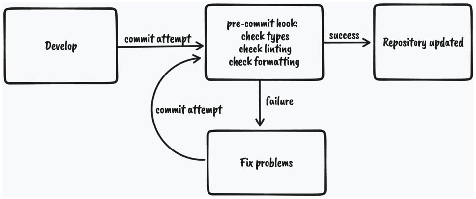

## Rendering:

Rendering means React figuring out what should appear on the screen based on your code and data.

> The simplest option is <mark>Client-side rendering (CSR)</mark>: all your React code runs in the browser. The server sends a minimal HTML file, JavaScript downloads and executes, and React builds the UI. This is perfect for applications behind authentication.

CSR: Browser receives JavaScript → React creates HTML → User sees the page

> But what if you want to make it as easy as possible for search engines to crawl your application? Then you might need <mark>Server-side rendering (SSR)</mark>: your React code executes on the server to generate HTML, which is sent to the browser. The browser displays it immediately, then downloads the JavaScript and "hydrates" the page to make it interactive.
* React run twice.

SSR: Server runs React → Browser receives ready HTML → User sees the page → React hydrates it → Page becomes interactive.

> Or perhaps your content doesn't change often, so you can use static site generation (SSG), pre-
render HTML at build time, and serve it from a CDN.

<mark>Hydration</mark> is mainly about making that page interactive, not adding its design. When Browser downloads JavaScript the Hydrartion happens. For example, at first Button will just show, will not work. After hydration, button will work.

Website Performance Metrics
### LCP
- Largest Contentful Paint
- Measures how quickly the main content becomes visible
- ex:
    - The browser starts loading the page
    - The main product appears after 2 sec
    - So, LCP = 2 sec

### FID
- First Input Delay
- Measures how long the browser takes to start responding to your first interaction
- ex:
    - You open a website
    - Click a button
    - It takes 150 ms before browser process it
    - So, FID = 150 ms

### CLS
- Cummulative Layout Shift
- Measures how much the page layout unexpectedly shifts

### Lazy Loading
- Means loading a page's JavaScript only when the user visits that route, instead of downloading every page's JavaScript at the beginning.

Without lazy loading:
```
User visits /home
       |
       v
Downloads JavaScript for:
  Home
  Dashboard
  Profile
       |
       v
Displays Home
```
With lazy loading:
```
User visits /home
       |
       v
Downloads Home's JavaScript
       |
       v
Displays Home
       |
       | User navigates to /profile
       v
Downloads Profile's JavaScript
       |
       v
Displays Profile
```

**<mark>TanStack Query (React Query):</mark>** is used in React to fetch, cache, synchronize, and update data from APIs.
```
React Frontend
      |
      | Requests users
      v
TanStack Query
      |
      | Checks Cache
      |
      | Data available?
      |
      | YES → Returns cached data
      |
      | NO → Fetches from API
      v
Backend API
      |
      v
PostgreSQL
```


* It uses in-memory cache.

### Cookie-Based Authentication
Cookie-based authentication means the server uses a cookie to remember that a user has logged in.

Instead of sending a username and password with every request, the browser automatically sends an authentication cookie.

Complete Authentication Flow
Imagine you have:

>React → Express Backend → PostgreSQL

```
              USER
                |
                | 1. Enters email + password
                v
          REACT FRONTEND
                |
                | 2. POST /login
                v
           BACKEND SERVER
                |
                | 3. Verifies credentials
                v
             POSTGRESQL
                |
                | 4. User verified
                v
           BACKEND SERVER
                |
                | 5. Creates session
                | 6. Sends Set-Cookie
                v
              BROWSER
                |
                | 7. Saves cookie automatically
                |
                | 8. Requests /profile
                |    Cookie sent automatically
                v
           BACKEND SERVER
                |
                | 9. Validates session
                v
        RETURNS PROFILE DATA ✅
```
### Session VS Cookie
| Session | Cookie |
|--------|--------|
| Usually stored on the server | Stored in the browser |
| Contains session information | Contains the session ID |
| Helps the server remember the user | Helps the browser identify its session |
| Can be invalidated by the server | Can be deleted or expire |


* A session is a temporary record that the server uses to remember a logged-in user across multiple HTTP requests.
* This information can be stored in PostgreSQL or Redis.

Complete Flow:
1. User logs in → Server verifies email and password.
2. Server creates a session → Generates a unique session ID and stores it with the user ID in the session database.
3. Server sends the session ID → Using the Set-Cookie HTTP response header.
4. Browser stores the cookie → Containing the session ID.
5. User visits a protected page → Browser automatically sends the cookie.
6. Server receives the session ID → Looks up the corresponding session in the session store.
7. Server validates the session → Checks whether it exists, hasn't expired, and is valid.
8. User gets access → Server identifies the user and returns the protected content.

> Who decides the session duration? Ans: The backend developer.

## Meta Framework
- A meta-framework is a framework built on top of another framework or library, providing additional features to build complete applications.

- React is a JavaScript library primarily used to build user interfaces.

- React itself doesn't provide a complete solution for:
    - Routing
    - Server-Side Rendering (SSR)
    - Backend API endpoints
    - Data fetching architecture
    - SEO optimization
You typically need additional tools to implement these.

- <mark>Next.js</mark> is a React meta-framework.

### React Router
- Which UI should appear for a particular URL.
- Routes, Route, BrowserRouter, and Link are components provided by the React Router library
    - BrowserRouter → Enables client-side routing.
    - Routes → Groups route definitions.
    - Route → Defines which component appears for a URL.
    - Link → Navigates between routes without a full page reload.
- React Router checks the URL and determines which component React should render.
- In framework mode, it's also a meta framework.

### Get started with React Router
To get started with a new project, we can use the create‑react‑router CLI and generate a new
project with the following command:

> npx create-react-router@latest client

### What happens during production?
> When you run: npm run build

Vite performs several optimizations.

1. Bundling: Combines related JavaScript modules into fewer files.

2. Minification: Removes unnecessary spaces, comments, and shortens code where safe.

3. Tree Shaking: Removes unused code.

4. Transformation: Converts JSX and TypeScript into browser-compatible JavaScript.

5. Code Splitting: Separates code into chunks so everything doesn't need to load immediately.

```
// vite.config.ts
import tsconfigPaths from "vite-tsconfig-paths";

export default defineConfig({
plugins: [ tsconfigPaths()],
});
```

```
React Code (.tsx / .ts)
        |
        v
     Vite Build
        |
        | Removes TypeScript types
        | Transforms JSX
        | Bundles and optimizes code
        v
   JavaScript (.js)
        |
        v
Browser executes JavaScript ✅
```


> The tsconfigPaths() plugin: This plugin allows us to use @/ as an alias for
our src directory in TypeScript files, so we can write @/components/button instead
of ../../../components/button

## TypeScript
Think of it as JavaScript with a safety net; it helps us catch errors before they happen in production. TypeScript catches these issues at compile time.

<mark>package.json file</mark>  that runs both React Router's type
generation and TypeScript compilation:
> "typecheck": "react-router typegen && tsc"

In React Router Framework Mode, this script is used to check your TypeScript code for errors before running or deploying it.

1. **react-router typegen** Generates TypeScript types automatically for your routes.

2. **tsc** is the TypeScript compiler. It checks whether your TypeScript code contains type errors.

### npm run typecheck
> npm run typecheck

Executes the script in package.json:
"typecheck": "react-router typegen && tsc"

```
Flow:
Generate React Router types
          ↓
Check TypeScript code
          ↓
Report errors (if any)
```
Best for checking the entire project.

## Linting
It's the process of analyzing our source code to find potential errors, bugs, stylistic errors, and suspicious constructs

Running ESLint
We can run linting using our configured scripts:

Run linting on all files:
- npm run lint

Run linting and automatically fix what can be fixed:
- npm run lint:fix

Run linting on specific files or directories:
- npx eslint src/features/ideas/
- npx eslint src/components/button.tsx

## pre-commit hooks
- Pre-commit hooks are scripts that run automatically before we can commit our code to the repository.
- Git hooks are scripts that Git runs at certain points in the Git workflow. The pre-commit hook runs just before a commit is created, and if it exits with a non-zero status, the commit is blocked.



To enable this flow, we will use husky and lint‑staged:

- <mark>husky</mark> is a tool that allows us to run Git hooks. We want to run the pre-commit hook to run the checks before committing our changes.

- <mark>lint‑staged</mark> is a tool that allows us to run those checks only on files that are in the staging area of Git. This improves the speed of code checking since doing that on the entire code base might be too slow.

Before starting, we need to make sure the Git repository is initialized if it isn't already. Then we can install husky and lint‑staged with the following commands:
> npm install --save-dev husky lint-staged

Then, we would need to initialize husky to enable Git hooks:
> npx husky init39

Setup and Project Structure Overview
A new folder named .husky will be created with a file named pre‑commit that will contain the following content:
> npm test

Let's modify the file to run the lint‑staged script:
> npm run lint-staged

### Running pre-commit checks
We can run our pre-commit checks manually:
Run all pre-commit checks (linting, formatting, type checking)
npm run pre-commit

**Run only lint-staged (checks only changed files)**
>npm run lint-staged

**Run individual checks**
> npm run lint

> npm run format

> npm run typecheck

### What does Husky actually do?
Imagine you're committing code:
> git add .

> git commit -m "Add login feature"

```
With Husky configured:
       git commit
           |
           v
     Husky triggers
    pre-commit hook
           |
           v
    npm run pre-commit
           |
     ---------------
     |      |      |
   ESLint Prettier TypeScript
     |      |      |
     ---------------
           |
           v
    All checks pass?
           |
      YES  |  NO
       |       |
       v       v
    Commit   Commit
    allowed  blocked
```

lint-staged runs code-checking or formatting tools (like ESLint and Prettier) only on Git-staged files.

Does lint-staged check code itself?
No! This is the important part.
- lint-staged → Finds staged files and passes them to configured tools.
- ESLint → Checks code for potential problems.
- Prettier → Formats code.

### File type structure
Here's how a file-type-based structure typically looks in a project:
```
src/
├── components/
├── pages/
├── hooks/
├── utils/
└── types/
```

Feature-based structure
Here's how a feature-type-based structure typically looks in a project:
```
src/
├── app/
├── components/
├── features/
│   ├── auth/
│   ├── ideas/
│   ├── profile/
│   └── reviews/
└── lib/
```

### ESLint
It tells that You can import from **higher levels** to lower levels, but not the reverse.
```
       APP (High)
          |
          | ✅
          v
     FEATURES (Mid)
          |
          | ✅
          v
     SHARED (Low)
```

- App imports Feature -> Correct ✅

- Shared imports Feature -> violates architecture(allowed by JS, but not by ESLint) ❌

### Enforcing project structure with ESLint

```
client/
├── app/
├── features/
├── components/
├── infra/
│   └── eslint-import-rules.js  ← Write import rules here
├── eslint.config.js            ← Use those rules here
└── package.json
```

> infra/eslint-import-rules.js -> This file defines which imports are forbidden.

> eslint.config.js -> This file loads the rules and passes them to ESLint through the appropriate plugin.

You write the import rules in infra/eslint-import-rules.js, but ESLint enforces them through eslint.config.js

```
// infra/eslint-import-rules.js

zones.push({
target: [
'./src/components/**',
'./src/config/**',
'./src/hooks/**',
'./src/lib/**',
'./src/stores/**',
'./src/types/**',
'./src/utils/**',
],
from: ['./src/features/**', './src/app/**'],
message:
'Shared utilities should not import from features or app directories.',
});
```

- In target files, we can't import anything from **from** files/.
- This rule ensures that shared folders (components, config, hooks, lib, stores, types, and utils) cannot import from features or the app.

```
/ infra/eslint-import-rules.js

const features = [
{ name: 'auth', allowedFeatures: [] },
{ name: 'ideas', allowedFeatures: ['auth'] },
{ name: 'profile', allowedFeatures: ['auth'] },
{ name: 'reviews', allowedFeatures: ['auth'] },
];
```
- This creates a dependency configuration where we have the following:

    - auth is the foundation; it cannot import from other features
    
    - ideas, profile, and reviews can only import from auth

    - No feature can import from features at the same level (e.g., ideas cannot import from profile)

### Route and Route Module

- Route → A URL path, such as /ideas.

- Route module → A file containing the logic and UI for that route.

## Link vs NavLink vs useNavigate
- Link → Simply navigates to another page.

- NavLink → Navigates to another page and knows whether that route is currently active.
- useNavigate -> Used when you want to redirect a user after successfully submitting a form for example.