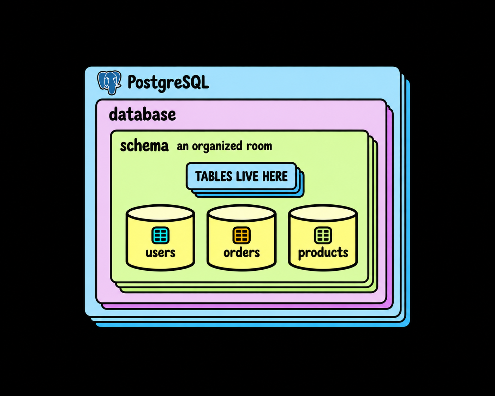
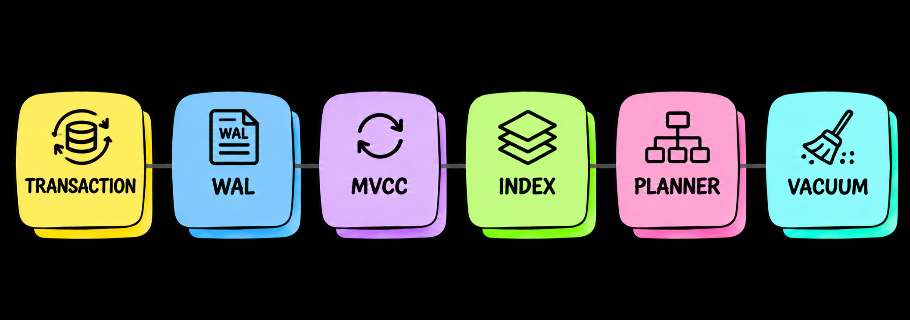

# PostgreSQL

Production Based Data Engine. It runs as an server. It is a declarative language.


**Schema** organizes the database objects(e.g: table) and keeps them logically separated.

In table:

        Row -> Record

        Column -> Field

It doesn't just store data; it enforces the shape also which was declared by the user when creating the table. So, wrong data type will be rejected by the engine automatically.

For example: If anyone puts "hello" in price column, it will be auto rejected.

Constraints are rules that you set on a table to control what data can be stored in it.
```
CREATE TABLE users (
    id INTEGER PRIMARY KEY,
    name TEXT NOT NULL,
    email TEXT UNIQUE,
    age INTEGER CHECK (age >= 18)
);
```

PostgreSQL has 3 things: <mark>Parse</mark>, <mark>Plan</mark> and <mark>Execute</mark>

## (1) Parser

Checks if syntax/grammar is correct or not.
Convers raw text into internal structure(that DB understands)

```
example: INSERT INTO orders (user_id, amount) values (1, 240)
```
Here:
- insert -> keyword
- orders -> table name
- user_id, amount -> column name
- 1, 240 -> values

## (2) Planer
It finds the cheapest path. It creates execution plan, that later Executor executes. You can say it is the brain of PostgreSQL engine.

Query Planner considers different execution methods (algorithms) to find the most efficient way to execute your query.

## (3) Executer

It follows the plan of the Planner. It:

    - reads table
    - read indexes
    - update row
    - apply filters

---
In PostgreSQL, Writing is not same as just dropping a new row on the file. It needs to maintain:

- Transaction Safety
- Crash Safety
- Concurrency

### Termionologies:
<mark>Index:</mark>
- Used for fast query
- Normally email/id are kept as index at the start while building the table
- Primary key and Unique is reserve as index
- Fastens Read operation, but slows Write operation

<mark>Migration:</mark>
- This command is used structure of the table is changing; not when querying in table like adding or deleting data

<mark>Explain Command:</mark>
- What PostgreSQL plans to do
- the EXPLAIN command is used to understand how PostgreSQL plans to execute a SQL query.

```
EXPLAIN
SELECT *
FROM orders
WHERE user_id = 10;
```

PostgreSQL returns an execution plan containing information such as:
- Scan Type: Will it use Sequential Scan or Index Scan?
- Cost: Estimated execution cost.
- Rows: Estimated number of rows returned.
- Width: Estimated average size of each output row in bytes.

```
Seq Scan on orders
  (cost=0.00..35.50 rows=5 width=40)
  Filter: (user_id = 10)
```

This tells us PostgreSQL plans to:
- Perform a Sequential Scan on orders.
- Check each row against user_id = 10.
- Return approximately 5 rows.


## PostgreSQL Connections


### Transaction:
A transaction is a group of database operations treated as one single unit.

> Either all operations succeed, or none of them are applied.
- All okay -> Commit(All saved)
- Any fail -> Rollback(Undo all)

Transaction follows <mark>ACID</mark> properties:

    - Atomicity: All or nothing
    - Consistency: Must keep the DB valid according to its defined rules
    - Isolation: Transactions Don't Interfere Incorrectly
    - Durability: Once a transaction is successfully committed, its changes should survive a system crash

### MVCC(Multi-Version Concurrency Control)
PostgreSQL mechanism that allows multiple transactions to access the same data without unnecessarily blocking each other.

How does MVCC work?
Suppose Alice's balance is $100.

Bob updates it to $150.

Instead of immediately overwriting the old row, PostgreSQL creates a new version of the row.
```
       Account Table
             |
       Old Version
       Balance: $100
             |
       New Version
       Balance: $150
```
- Alice's transaction can still see the old version if its snapshot allows it.
- Bob's transaction sees the new version.
PostgreSQL manages which version each transaction can see.

What happens to old versions?
PostgreSQL doesn't keep old versions forever.

Its VACUUM process eventually cleans up old row versions that are no longer needed.

### VACUUM
it's a PostgreSQL maintenance process that cleans up old, unused row versions.

**Tuple:** A tuple is a row (record) in a PostgreSQL table.
**Dead Tuple:** A dead tuple is an old row version that is no longer needed by any active transaction.

planner uses Table Statistics while planning. Autovacuum trigers Analyze which refreshes stats.

```
       Data Changes
     (INSERT / UPDATE / DELETE)
               |
               v
          AUTOVACUUM
               |
               v
           ANALYZE
               |
               v
     Refreshes Table Statistics
               |
               v
        QUERY PLANNER
               |
               v
    Chooses Execution Plan
```

- Autovacuum: Automatically decides when table maintenance is needed.
- ANALYZE: Collects information about the table and updates statistics.
- Table Statistics: Store information about row counts, value distribution, etc.
- Query Planner: Uses those statistics to estimate costs and choose an execution plan.

**PgBouncer:**

PgBouncer is a lightweight connection pooler for PostgreSQL.

It manages and reuses database connections so PostgreSQL doesn't have to handle too many connections directly.

Suppose PgBouncer has 50 database connections available.
1. Users send database requests.
2. PgBouncer assigns available connections.
3. After a transaction finishes, the connection can be reused.
4. Other users can use the same connection.


### WAL(Write Ahead Log)
- WAL is written before the modified data page is written to the database files, not necessarily before the SQL operation starts.

- It keeps the logs
- Like Blackbox in Aeroplane
- The foundation of durability

Step 1: PostgreSQL receives the UPDATE query.

Step 2: It changes the relevant data in memory.

Step 3: It records the change in WAL.

Step 4: PostgreSQL saves the WAL record to disk when committing the transaction.

Step 5: The actual database page can be written to disk later

---