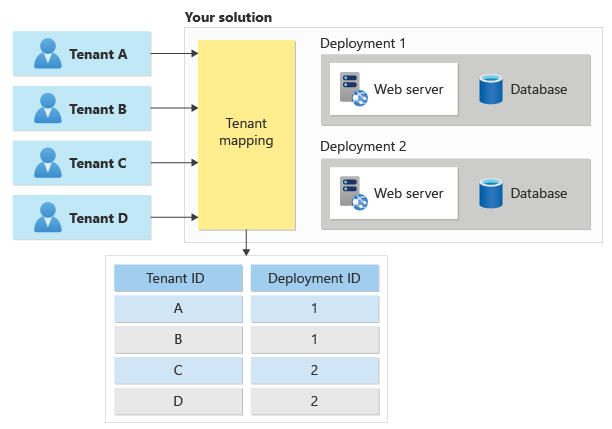
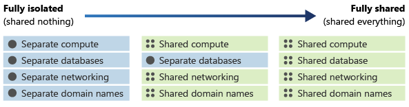
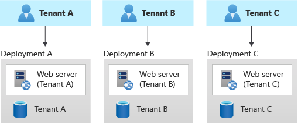
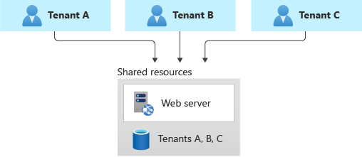
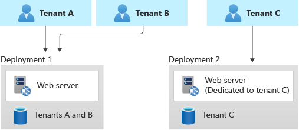
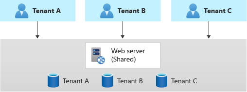

## Multitenancy

- A multitenant solution is a solution used by multiple customers, or tenants. 
- Multiple users from a single organization, company, or group form a single tenant. 
```
       One SaaS Application
               |
       -------------------
       |        |        |
    Org A     Org B    Org C
       |        |        |
     Data A   Data B   Data C
```

## Define a tenant

need to first define a tenant for your organization

**B2B (Business to Business):** A business sells software to other organizations.

Customer: The organization buying your software (e.g., ABC Bank).

Tenant: An isolated environment for that customer.

User: An individual employee using the software.

**B2C (Business to Consumer)**
B2C: A business sells software directly to individual people.

Unlike B2B, customers might be individuals or groups (families, friends, clubs).

Customer: A person or a group (family, friends, club).

Tenant: An isolated environment where customer data is managed.

User: An individual who uses the application

Example: Music Streaming Application (Spotify)

Selecting a model depends on commercial and business decisions both.
If you expect your business to scale to a large number of customers, it's important to deploy shared infrastructure. Otherwise, you have to maintain a large and growing fleet of resource instances.

If you expect that your business will have only a few customers(Org in B2B and im B2C individual or group), you might want to consider using single-tenant resources that are dedicated to each customer.

---
A key difference between tenants and deployments is how isolation is enforced. When multiple tenants share a single deployment, you typically rely on your application code and a tenant identifier that's in a database to keep each tenant's data separate. When tenants have their own dedicated deployments, they have their own infrastructure, so it might be less important for your code to account for a multitenant environment.

Deployments are sometimes referred to as supertenants or stamps.





Bin packing means filling one server/deployment with customers until it reaches its capacity, then using another one.

### Tenant Isolation


## Common tenancy models

### Automated single-tenant deployments


N.S: <mark>Deployment Stamp Pattern</mark> = Creating multiple copies of your application infrastructure to serve different customers is a possible option for this

Benefits:
1) Solves Noisy Neighbor Problem
Noisy Neighbor means one tenant consumes too many shared resources, making the application slower for other tenants.
2) Regulatory Compliance Overhead
Regulatory compliance means following rules and laws set by authorities.

## Fully multitenant deployments


## Vertically partitioned deployments
> Different customer groups → Different deployments.

Use a combination of single-tenant and multitenant deployments.



## Horizontally Partitioned Deployment

> Separate application components. Share the application, separate the databases.


