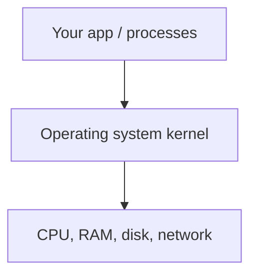
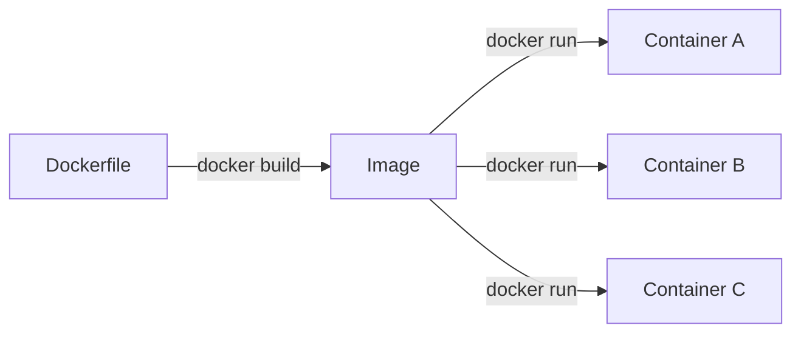
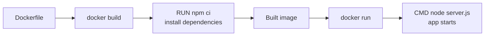
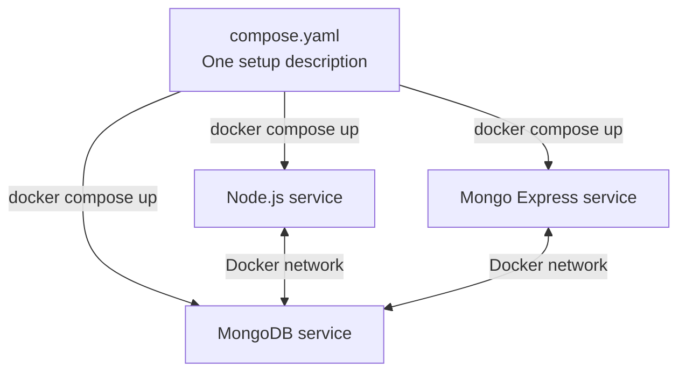

## 1.  What is Docker?

Docker helps you <mark>package an application with the files and dependencies it needs</mark> so it can run in a consistent environment.

Imagine your app needs Node.js, a specific package version, and some configuration. Rather than setting everything up manually on every computer, you prepare a Docker **image** that describes the application environment and start a **container** from it.

### The important parts of a computer



- The **kernel** is the part of the operating system that manages things like processes, memory, hardware access, and filesystems.
- Your notes say Docker *"virtualizes the application layer."* An easier, more precise statement: <mark>Docker isolates application processes and files while containers share the host's kernel</mark> (for Linux containers).
- A Docker image may include a minimal Linux **userspace** (such as Alpine), but it does **not** contain its own separate Linux kernel.

> A container is **not a full virtual machine**. A VM generally has its own guest operating system and kernel. Multiple Linux containers on the same Docker host typically share one kernel, but have isolated processes, filesystems, and networking.


---

## 2. Image vs Container

| Concept | Simple meaning | Remember it as |
| --- | --- | --- |
| **Docker image** | Packaged filesystem and instructions used to create containers | A **recipe / blueprint** |
| **Docker container** | A running or stopped instance created from an image | A **cake made from the recipe** |
| **Dockerfile** | Instructions for building an image | How to **write the recipe** |
| **Docker Engine** | Software that builds images and manages containers | The **worker** |

<mark>One image can be used to create many containers.</mark>



**The distinction:** An image is a reusable template. A container is one particular instance, with its own runtime state and writable layer.


> Creating another container with `docker run` does **not** automatically resume the previous one. Use `docker start <name>` to start an existing stopped container.


---

## 3.  Docker commands you should know

### Inspect what you have

```bash
docker images       # List downloaded / built images
docker ps           # List running containers
docker ps -a        # List running + stopped containers
```

### Download an image and run a container

```bash
docker pull nginx:alpine
# Get the image from a registry (Docker Hub by default)

docker run --name web-demo -d -p 8080:80 nginx:alpine
# Create a NEW container, run it in background, expose it on localhost:8080
```

Open **http://localhost:8080** in your browser.

Breakdown:

| Piece | Meaning |
| --- | --- |
| `docker run` | Create **and** start a new container |
| `--name web-demo` | Give this container a memorable name |
| `-d` | Detached mode: run in the background |
| `-p 8080:80` | Send traffic from **host port 8080** to **container port 80** |
| `nginx:alpine` | Image to start (name + tag) |

<mark>Read port mapping as `HOST_PORT:CONTAINER_PORT`.</mark>

```text
Your browser                 Your computer             Docker container
localhost:8080  -----------> host port 8080 --------> nginx at port 80
```

### Read logs, stop, and restart

```bash
docker logs web-demo       # Show container output
docker logs -f web-demo    # Follow new log lines

docker stop web-demo       # Stop the existing container
docker start web-demo      # Start THAT SAME container again

docker rm web-demo         # Remove it (after stopping)
```

### More commands from your notes

```bash
docker run -d nginx:alpine         # Run in background; Docker generates a name
docker stop <container-name-or-id> # Stop a container
docker version                     # Client/server version information
```

> If an image is missing, `docker run` normally tries to pull it automatically. The image examples in the handwritten notes use older versions of nginx; `nginx:alpine` here is just a simple demonstration tag.


---

## 4. Registry vs Repository vs Image

Your handwritten notes describe a registry as a **storage and distribution system for Docker images**. That's right.

Think of the relationship like this:

```text
Docker Registry (e.g. Docker Hub)
└── Repository: nginx
    ├── Tag: alpine
    ├── Tag: stable-alpine
    └── Other tags / versions
```

- **Registry:** A service where images are stored and downloaded from. Example: <mark>Docker Hub</mark>.
- **Repository:** A named collection of related images/versions, such as `nginx`.
- **Tag:** A human-readable label selecting an image version or variant, such as `alpine`.
- **Image:** The actual packaged layers/configuration used to start a container.

```bash
docker pull nginx:alpine
# nginx  = repository
# alpine = tag
```

> Tags are labels and can change over time. For reproducible deployments, choose an appropriate fixed version or image digest rather than relying on moving tags.

---

## 5. Dockerfile: build your own image

A <mark>Dockerfile is a text file containing instructions for how Docker should build an image</mark>.

Your notes use a Node.js application. Here's a beginner-friendly version following that same structure.

### Example folder

```text
app/
├── Dockerfile
├── .dockerignore
├── package.json
├── package-lock.json    # present after npm install
└── server.js
```

### Dockerfile

```dockerfile
FROM node:24-alpine

WORKDIR /home/app

COPY package*.json ./
RUN npm ci

COPY . .

EXPOSE 3000
CMD ["node", "server.js"]
```

| Instruction | Easy meaning | **When** it happens |
| --- | --- | --- |
| `FROM node:24-alpine` | Begin with an existing image containing Node.js and minimal Linux userspace | **Build** |
| `WORKDIR /home/app` | Use `/home/app` as the working folder inside the image; create it if absent | **Build** |
| `COPY package*.json ./` | Copy package files from your local build context into the image's current folder | **Build** |
| `RUN npm ci` | Install Node dependencies into the **image's filesystem** | **Build** |
| `COPY . .` | Copy your application files into that working folder | **Build** |
| `EXPOSE 3000` | Document that the app expects to listen on port 3000; **doesn't publish it** | **Build metadata** |
| `CMD ["node", "server.js"]` | Default command when the container starts | **Container start** |

### `RUN npm install` — a common beginner question

Your handwritten notes use `RUN npm install`. That works. Here's what it actually means:

1. Docker is **building an image** from your Dockerfile.
2. It reaches `RUN npm install` (or `RUN npm ci`).
3. It executes the command **inside a temporary build container**, using the image's filesystem.
4. The resulting installed dependencies become part of the **built image**.
5. Later, a container created from that image can use those installed packages.

<mark>`RUN npm install` executes at image build time — not every time your container starts.</mark>

**Why use `npm ci` here?** It installs from an existing `package-lock.json` consistently. If you **do not have a lockfile yet**, first generate one with `npm install` locally (or use `RUN npm install` as a simpler first step).

### `.dockerignore` (good practice)

```dockerignore
node_modules
.env
.git
npm-debug.log
```

This prevents your host's `node_modules`, secrets, and unnecessary files from entering the Docker build context. The container still gets its own dependencies from `RUN npm ci`.

### Build and run

From inside the `app/` directory:

```bash
docker build -t my-node-app:1.0 .
# -t = set image name:tag
# .  = current directory as the build context

docker run --name my-node-container -d -p 3001:3000 my-node-app:1.0
# Visit http://localhost:3001 if server.js listens on port 3000
```


> Your Node server should listen on `0.0.0.0`, not only `127.0.0.1`, so it can be reached through Docker's published port.

### Build-time vs start-time




---

## 6. Docker networking

By default, containers can have their own isolated network environment. If two services need to communicate, you can put them on the same Docker network.

### Manual network commands (from your notes)

```bash
docker network create my-network

docker run -d --name first --network my-network nginx:alpine

docker run -d --name second --network my-network nginx:alpine

docker network rm my-network
# Run this ONLY after disconnecting/removing containers using it
```

On a user-defined bridge network, containers can generally refer to one another by **container name**. For example, another container on `my-network` can resolve `first`.

### Inside vs outside — two different questions

- **Container → container:** Use the shared network and the other container's **service/container name**.
- **Your browser/host → container:** Usually publish a port with `-p HOST:CONTAINER`.


> Inside a container, `localhost` means **that container itself**. If your Node app needs MongoDB in another Compose service, use the hostname **`mongodb`**, not `localhost`.


**No, not for the API-to-MongoDB connection.** Containers on the same network can communicate using the MongoDB service name and its container port. Publish `27017` only if a program **on the host** must access MongoDB directly.

</details>

---

## 7. Docker Compose in easy words

### First, imagine doing everything by hand

You have an application with three parts:

1. Node.js app
2. MongoDB database
3. Mongo Express database viewer

Without Compose, you may need to create a network, start each container with several options, connect them, and manage them individually.

<mark>Docker Compose means: describe all these containers in ONE YAML file, then start them together with ONE command.</mark>

**A helpful analogy:**

- **Dockerfile = how to prepare one meal** (build an image).
- **Compose file = the full restaurant order** (which services to run and how they connect).



### The smallest runnable Compose example

Save this as `compose.yaml`:

```yaml
services:
  web:
    image: nginx:alpine
    ports:
      - "8080:80"
```

In the folder containing the file:

```bash
docker compose up -d       # Create and start the web container
docker compose ps          # Show Compose-managed containers
docker compose logs web    # Show web service logs
docker compose down        # Stop and remove containers and Compose network
```

Visit **http://localhost:8080** while it is running.

### Read the YAML one line at a time

| Field | In easy words |
| --- | --- |
| `services:` | The list of containers you want Docker Compose to manage |
| `web:` | The name of one service (you choose this) |
| `image: nginx:alpine` | Start this service from an existing image |
| `build: ./app` | Instead of using only a prebuilt image, build one from the Dockerfile in `./app` |
| `ports:` | Make a container port reachable from the host |
| `environment:` | Pass environment variables into the container |
| `volumes:` | Attach folders/storage at paths inside the container |
| `depends_on:` | Start dependencies before this service; **not necessarily wait until ready** |

> [!IMPORTANT]
> Docker Compose automatically sets up a **default network** so its services can refer to each other by service name. You usually don't need to run `docker network create` yourself.

### `depends_on` is not a readiness check

```yaml
depends_on:
  - mongodb
```

This tells Compose to start the MongoDB service before the app. <mark>It does not guarantee that MongoDB is ready to accept connections.</mark> For that, add a MongoDB health check and depend on `condition: service_healthy`, or implement retries in the app.

### Commands from your handwritten notes

```bash
docker compose -f mongo-services.yaml up -d
# Creates and starts all services defined in that YAML file

docker compose -f mongo-services.yaml stop
# Stops services but keeps containers

docker compose -f mongo-services.yaml start
# Starts those stopped containers again

docker compose -f mongo-services.yaml down
# Stops and removes Compose containers and its network
```

More useful commands:

```bash
docker compose up -d --build  # Rebuild images when necessary, then start
docker compose ps             # Show service status
docker compose logs -f        # Follow service logs
docker compose config         # Validate and display resolved configuration
```


**Dockerfile:** Builds an image for one application.  
**Compose file:** Describes which services to run, which images to build/use, ports, networks, environment variables, and storage.

Compose does not replace the Dockerfile. They can work **together**.

</details>

---

## 8. Volumes and mounts explained simply

This is the **most important new section**, especially for the two confusing lines in your project.

### 8.1 What does **mount** mean?

A **mount** means: <mark>make a folder or storage location available at a particular path inside a container.</mark>

Think of a container as a **room**. By default, the room has its own files. A mount gives the room access to another storage location.

**Example: your laptop's folder appears inside the container.**

```text
YOUR LAPTOP (host)                  DOCKER CONTAINER

my-project/app/                     /home/app/
  server.js     ────── shared ────>   server.js
  package.json  ────── shared ────>   package.json
```

It's not just a one-time copy: with a normal **bind mount**, edits to the shared files are generally visible on both sides.

> [!TIP]
> **Host** simply means *your computer or the machine running Docker*. **Container** means the isolated running environment created by Docker.

### 8.2 Two main kinds of storage you'll meet

| Storage type | Who chooses / manages its location? | Best for | Example |
| --- | --- | --- | --- |
| **Bind mount** | **You** choose a real host folder | Source code you're editing | `./app:/home/app` |
| **Docker volume** | **Docker** manages the storage | Database data, container-owned dependencies | `mongo_data:/data/db` |

A Docker volume can be **named** (e.g., `mongo_data`) or **anonymous** (Docker generates an identifier).

> [!IMPORTANT]
> The word **`volumes:`** inside Compose can contain **both bind mounts and Docker volumes**. So a line under `volumes:` is not automatically a Docker-managed volume.

### 8.3 First line: `./app:/home/app`

```yaml
volumes:
  - ./app:/home/app
```

Read it from **left to right**:

```text
./app                    :             /home/app
host folder                            container folder
(on your laptop)                       (inside Docker)
```

**Meaning:** <mark>Show my local `app` folder at `/home/app` inside the container.</mark>

- `./app` = the `app` folder relative to your Compose file's directory.
- `/home/app` = the place where the container sees those files.
- Update `./app/server.js` in VS Code → the updated file appears at `/home/app/server.js` in the container.
- If your Node app is running with a file watcher such as `nodemon`, it **may** restart automatically; a bind mount alone doesn't restart the process.

**Why use this?** During development, you can change your code without rebuilding the entire image for every small edit.

### 8.4 Second line: `/home/app/node_modules`

```yaml
volumes:
  - /home/app/node_modules
```

**There is no `:` here.** That matters.

This tells Docker: <mark>Create a separate **anonymous Docker volume** and mount it at `/home/app/node_modules` in the container.</mark>

- Docker decides where the volume data is stored.
- This path is **inside the container**, not a local directory you named.
- It does **not** mean "copy `/home/app/node_modules` from my laptop."

#### Why is it needed together with the first line?

Suppose the Dockerfile ran `RUN npm install` and put Node dependencies at:

```text
/home/app/node_modules
```

Then you bind-mount your local `./app` folder over `/home/app`. That bind mount **hides the image's existing files under `/home/app`**. If your host doesn't have `node_modules`, those image-installed dependencies won't be visible there.

So you add a **separate mount just for `node_modules`**.

```text
        LAPTOP / HOST                         CONTAINER
        ─────────────                         ─────────
        ./app/server.js      ───────────────> /home/app/server.js
        ./app/package.json   ───────────────> /home/app/package.json

        (host node_modules)   NOT USED HERE   /home/app/node_modules
                                            ▲
                                            │
                                  separate Docker volume
                                  (container's dependencies)
```

<mark>Result: your code comes from the host, but `node_modules` comes from Docker-managed storage.</mark>

**Why this helps:**

1. The container can keep Linux-compatible Node dependencies separate from your host's packages.
2. Your host source folder does not accidentally replace the container's dependency folder.
3. On first use, Docker normally copies existing files at the image's target path into a new empty volume, so image-installed dependencies can populate it.

> [!WARNING]
> An anonymous volume can survive container replacement or become stale after dependencies change. If packages are unexpectedly missing after rebuilding, inspect the mounts and consider recreating **only the app's anonymous volume**. Don't delete MongoDB's named data volume just to refresh `node_modules`.

### 8.5 Both lines together: the exact meaning

```yaml
services:
  my-app:
    volumes:
      - ./app:/home/app           # Bind mount: your code from the laptop
      - /home/app/node_modules    # Anonymous volume: app dependencies
```


With only `./app:/home/app`, the host folder covers `/home/app` in the container. If your host's `./app` does not contain working `node_modules`, the packages installed in the image may be **hidden** at runtime. The app may fail with a missing-package error.

If your host has `node_modules`, the container may see those host files instead; they can be incompatible with the container's environment. That is why separating them is useful during development.


Instead of an anonymous volume, use a **named** volume:

```yaml
services:
  my-app:
    volumes:
      - ./app:/home/app
      - app_node_modules:/home/app/node_modules

volumes:
  app_node_modules:
```

Now Docker calls it something like `<project>_app_node_modules` instead of assigning a random volume name. The purpose is the same, but you can refer to it by name. Named volumes persist unless you explicitly remove them.

</details>

### 8.6 Why databases need a volume

A container's ordinary writable layer is removed when the **container is removed**. But database records should survive replacing a database container.

```yaml
services:
  mongodb:
    image: mongo:8
    volumes:
      - mongo_data:/data/db

volumes:
  mongo_data:
```

Read it as: **store MongoDB's database files in a Docker-managed place called `mongo_data`, and mount that storage at `/data/db` inside MongoDB.**

```text
Docker named volume                   MongoDB container
mongo_data            ─────────────>  /data/db
(kept independently)                  (database writes here)
```

- `docker compose down` → containers and Compose network removed, **named volume normally stays**.
- `docker compose up -d` → MongoDB can use the same existing named volume again.
- `docker compose down -v` → <mark>removes Compose-managed named volumes too: database data can be permanently lost!</mark>

> Do **not** casually run `docker compose down -v` when your volume contains anything you want to keep.

### 8.7 Volume commands

```bash
docker volume ls                 # List Docker-managed volumes
docker volume inspect mongo_data # Inspect a volume (real name may include project prefix)
docker volume create my-data     # Make a named volume
docker volume rm my-data         # Delete unused named volume
```

With Compose, the real name is often prefixed: `<project>_mongo_data`. Use `docker volume ls` to find it.

To see exactly what is mounted in a running service:

```bash
docker compose ps
docker inspect <app-container-name> --format '{{json .Mounts}}'
```


---


### Start and inspect

```bash
docker compose config          # Verify configuration
docker compose up -d --build  # Build the Node image, start both services
docker compose ps             # Check status
docker compose logs -f my-app # Read Node app logs
docker compose logs mongodb   # Read database logs
```

### What happens when you run `docker compose up -d --build`?

1. Compose reads `compose.yaml` and substitutes values from `.env`.
2. It builds the `my-app` image using `app/Dockerfile`.
3. During the build, Docker executes `RUN npm ci` and installs dependencies **in the image**.
4. Compose creates a default network.
5. It starts MongoDB, the Node service, and Mongo Express (the viewer).
6. It mounts the **host app folder** into `/home/app` and a **separate anonymous volume** into `/home/app/node_modules`.
7. MongoDB uses the named `mongo_data` volume for `/data/db`.
8. Your laptop can reach the Node app at `localhost:3001` (if the app runs properly) and the Mongo Express viewer at `localhost:8081`.

### `docker compose stop` vs `down` vs `down -v`

| Command | What happens? |
| --- | --- |
| `docker compose stop` | Stop services, **keep containers** |
| `docker compose start` | Start the existing stopped containers |
| `docker compose down` | Remove containers and Compose network, **keep named volumes** |
| `docker compose down -v` | Remove containers/network **and Compose-managed volumes** — can delete DB data |


---

### Cheat sheet

| Want to… | Command |
| --- | --- |
| List images | `docker images` |
| List running containers | `docker ps` |
| List all containers | `docker ps -a` |
| Download image | `docker pull nginx:alpine` |
| Run image with published port | `docker run -d -p 8080:80 nginx:alpine` |
| Stop existing container | `docker stop <name>` |
| Restart existing container | `docker start <name>` |
| View container logs | `docker logs <name>` |
| Build an image | `docker build -t app:1.0 .` |
| Create network | `docker network create my-network` |
| Start Compose app | `docker compose up -d` |
| Build and start | `docker compose up -d --build` |
| Inspect Compose status | `docker compose ps` |
| Stop Compose app | `docker compose stop` |
| Resume stopped Compose app | `docker compose start` |
| Remove Compose containers | `docker compose down` |
| List volumes | `docker volume ls` |
| **Delete Compose volumes too** | **`docker compose down -v` ⚠️** |


